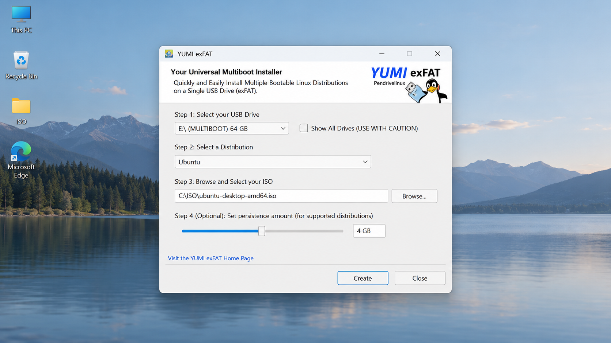
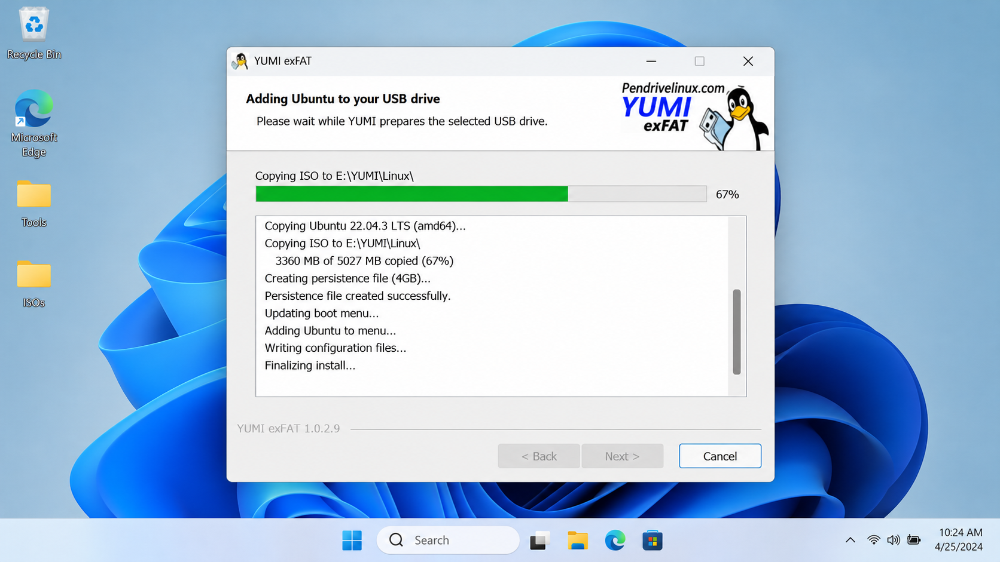
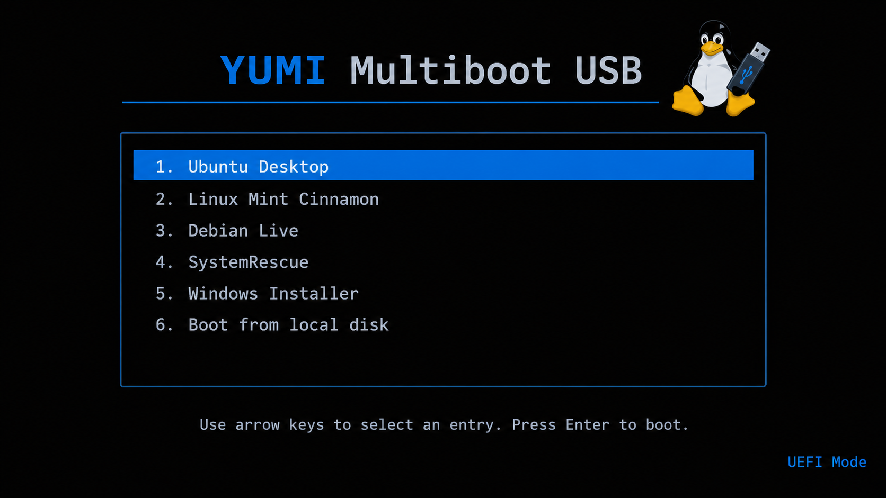

# Yumi Multiboot - Boot Multiple Operating Systems From One USB Drive

> Yumi Boot creates a flexible multiboot drive for operating systems, recovery environments, antivirus media, and diagnostic utilities.

## About

Yumi Boot provides the Yumi Multiboot desktop application for preparing one USB drive with multiple bootable images. A YUMI multiple ISO USB presents a boot menu from which users can launch Windows installers, live Linux distributions, recovery environments, and maintenance utilities.

Yumi Multiboot combines image selection, target-drive safeguards, progress reporting, and result validation in one interface. The source-selection flow is implemented in [src/source-selector.tsx](src/source-selector.tsx), while [src/drive-selector.tsx](src/drive-selector.tsx) handles destination selection.

## Features

- Stores multiple compatible ISO images on one Yumi boot drive.
- Supports Windows installation media and selected live Linux distributions.
- Provides YUMI UEFI bootable USB and YUMI legacy BIOS bootable USB workflows.
- Supports Yumi exFAT media for images larger than the FAT32 file-size limit.
- Offers YUMI persistent Linux USB options for compatible distributions.
- Detects removable drives and warns before destructive operations.
- Reports writing progress and verifies completed operations.
- Keeps ordinary storage space available where the selected layout permits it.
- Provides clear source, target, settings, and result screens.
- Uses a portable desktop interface suitable for a Yumi bootable pendrive.

The main workflow is coordinated by [src/Flash.tsx](src/Flash.tsx), [src/flash-state.ts](src/flash-state.ts), and [src/image-writer.ts](src/image-writer.ts). Drive restrictions are defined in [src/drive-constraints.ts](src/drive-constraints.ts), and supported image rules are represented by [src/supported-formats.ts](src/supported-formats.ts).

## Tested OS

Yumi Boot is intended for compatible Windows installers, Linux live systems, rescue environments, and diagnostic images. Actual compatibility depends on the image, firmware mode, partition layout, and persistence requirements.

| Image family | Typical use |
|---|---|
| Windows 11 | Installation and recovery media |
| Windows 10 | Installation, repair, and deployment |
| Windows 7 | Legacy installation on compatible hardware |
| Linux | Live sessions, installers, and selected persistence modes |
| System recovery | Antivirus, partitioning, backup, and diagnostic environments |

### What is the best USB bootable tool for Windows 10?

The best choice depends on whether the drive needs one installer or several environments. Yumi Boot is especially suitable when a single Yumi bootable Windows 10 drive must also contain Linux, recovery, or diagnostic images.

Yumi Multiboot emphasizes reusable multiboot media rather than a single-image workflow. A Yumi Windows 10 bootable drive can remain useful after installation because additional compatible images can be added to the same device. Firmware support, ISO compatibility, available capacity, and whether existing data must be preserved should all be checked before writing the drive.

## What does Yumi Multiboot do?

Yumi Multiboot allows users to:

1. Prepare a removable drive for multiboot operation.
2. Add compatible operating-system and utility images.
3. Select between UEFI and legacy BIOS requirements.
4. Review the chosen image and target before writing.
5. Track preparation progress and inspect the final result.
6. Add or remove supported entries as storage requirements change.
7. Configure persistence for selected Linux distributions.
8. Use exFAT when large image files require it.

### What is the best software to create a multiboot USB drive?

A suitable multiboot application should support the required firmware, image formats, operating systems, and filesystem limits. Yumi Boot is designed for users who need several boot choices on one removable device rather than a separate drive for every image.

Yumi Multiboot provides a focused Yumi multiboot USB creator workflow with source validation, removable-drive detection, progress reporting, and safety warnings. It is a practical choice when YUMI Windows 11 bootable USB media, Linux live images, and recovery utilities must share one drive. No application supports every ISO, so important images should be tested on the actual target hardware before they are relied upon.

## Installation

Yumi Boot is packaged as a desktop application. Review the project requirements, back up the destination USB drive, and close applications that may be using it before starting Yumi Multiboot.

Administrative access may be required for direct disk operations. Permission handling is implemented in [src/permissions.ts](src/permissions.ts), with elevation support in [src/askpass.js](src/askpass.js).

## Basic usage

1. Insert the USB drive and start Yumi Boot.
2. Select the required image through the source selector.
3. Choose the correct removable destination.
4. Review warnings, firmware requirements, and filesystem settings.
5. Start the write operation and wait for verification to finish.
6. Add further compatible images when building a Yumi multiboot drive.
7. Restart the target computer and select the USB device in its firmware boot menu.

The interface reports source-selection errors through [src/errors.ts](src/errors.ts) and operation progress through [src/progress-status.ts](src/progress-status.ts). Completed operations are presented by [src/flash-results.tsx](src/flash-results.tsx).

### How to create a boot from USB?

Begin by backing up the USB drive because preparing boot media can overwrite partitions and files. Open Yumi Boot, select a compatible ISO, and then choose the removable drive carefully. Confirm the selected filesystem and whether the target computer uses UEFI or legacy BIOS.

Start the operation and keep the drive connected until Yumi Multiboot reports completion. Add other compatible images if the device is intended to become a YUMI multiple ISO USB. Finally, restart the computer, open its firmware boot-device menu, select the USB drive, and choose the required entry from the multiboot menu.

### Can Rufus create a bootable ISO?

Rufus can write a bootable ISO to USB media, but it generally does not create a new bootable ISO from arbitrary files. Its common workflow prepares one image on one target drive.

Yumi Boot addresses a different requirement by organizing multiple compatible images on the same device. Yumi Multiboot is therefore more directly aligned with a reusable multiboot USB workflow. Users should still verify each image because boot behavior can vary between UEFI systems, legacy BIOS hardware, and individual ISO implementations.

## Dependencies

Yumi Multiboot uses a TypeScript desktop stack with packaged runtime components. Project metadata and scripts are defined in [package.json](package.json), compiler settings are stored in [tsconfig.json](tsconfig.json), and bundling is configured through [webpack.config.ts](webpack.config.ts).

### Required

- A supported Windows environment.
- Permission to access removable storage devices.
- A USB drive with sufficient capacity.
- A compatible ISO or disk image.
- Node.js and Yarn when building from source.

### Optional

- UEFI-capable hardware for modern boot workflows.
- Legacy BIOS support for older computers.
- An exFAT layout for large files.
- A compatible Linux image with persistence support.
- Additional recovery and diagnostic images for a broader Yumi multiboot collection.

## Installation Instructions

Back up the target drive before preparing it with Yumi Boot. Confirm the drive identity and capacity, select the required image, and review every warning before writing. Do not disconnect the drive while Yumi Multiboot is partitioning, copying, or validating data.

## Compile Instructions

Install the development dependencies described by [package.json](package.json), use the runtime version indicated by [.nvmrc](.nvmrc), and invoke the project scripts defined for development or packaging. Electron packaging behavior is configured in [forge.config.ts](forge.config.ts).

## Building

The primary application entry points are [src/app.ts](src/app.ts), [src/MainPage.tsx](src/MainPage.tsx), and [src/renderer.ts](src/renderer.ts). Platform-specific behavior is separated into [src/windows.ts](src/windows.ts), [src/linux.ts](src/linux.ts), and [src/darwin.ts](src/darwin.ts).

Run the relevant checks before producing a release. Tests cover drive discovery, image validation, selection state, settings, progress reporting, and the end-to-end workflow.

## Documentation / support

| Title | Local reference |
|---|---|
| Contributing | [CONTRIBUTING.md](CONTRIBUTING.md) |
| Security | [SECURITY.md](SECURITY.md) |
| Changes | [CHANGELOG.md](CHANGELOG.md) |
| License | [LICENSE](LICENSE) |
| Application metadata | [package.json](package.json) |
| Supported formats | [src/supported-formats.ts](src/supported-formats.ts) |

## Tested Image Report

Compatibility reports should identify the image version, target hardware, firmware mode, partition layout, filesystem, and persistence settings. Reports should also state whether Yumi Boot completed writing and whether Yumi Multiboot displayed and launched the entry successfully.

## Boot Media Vocabulary

yumi boot, yumi multiboot, yumi bootable usb, yumi multiboot usb creator, YUMI UEFI bootable USB, YUMI persistent Linux USB, multiboot, bootable-usb, usb-boot, iso, uefi, legacy-bios, live-usb, windows, linux

## How it was done

Yumi Multiboot separates image discovery, drive scanning, state management, and writing into focused TypeScript modules. Shared application state is managed in [src/store.ts](src/store.ts), while messages and localization behavior are handled by [src/messages.ts](src/messages.ts) and [src/i18n.ts](src/i18n.ts).

## How to add your own language

1. Add the language resources required by [src/i18n.ts](src/i18n.ts).
2. Translate user-facing messages without changing identifiers or placeholders.
3. Register the locale in the application resources.
4. Verify source selection, drive warnings, progress messages, and result screens.
5. Test elevated-access prompts where the operating system requires them.
6. Submit the change according to [CONTRIBUTING.md](CONTRIBUTING.md).

## Additional information

Yumi Boot displays operation details through the interface and captures exceptional conditions through [src/exception-reporter.ts](src/exception-reporter.ts). Window progress integration is implemented in [src/window-progress.ts](src/window-progress.ts), while target warnings are provided by [src/drive-status-warning-modal.tsx](src/drive-status-warning-modal.tsx).

## Enhancements/Bugs

Report defects with reproducible steps, the image type, firmware mode, filesystem, target-drive details, and the observed result. Security-sensitive findings should follow [SECURITY.md](SECURITY.md). Proposed enhancements should explain how they improve Yumi Boot without weakening drive-selection safeguards.

## Contributing

Contributions to Yumi Multiboot should follow [CONTRIBUTING.md](CONTRIBUTING.md). Changes should include relevant tests, preserve platform safeguards, and avoid writing to unselected devices.

## Support

Before requesting support, confirm that the ISO boots independently, the destination drive is detected correctly, and the target firmware supports the chosen mode. Include application logs and clear reproduction steps, but remove private information before sharing them.

## GitHub

Yumi Boot maintains the Yumi Multiboot repository. The repository contains the desktop interface, image-writing workflow, tests, configuration, security guidance, and release history.

## License

Yumi Multiboot is distributed under the terms in [LICENSE](LICENSE). Third-party components remain subject to their respective licenses.
